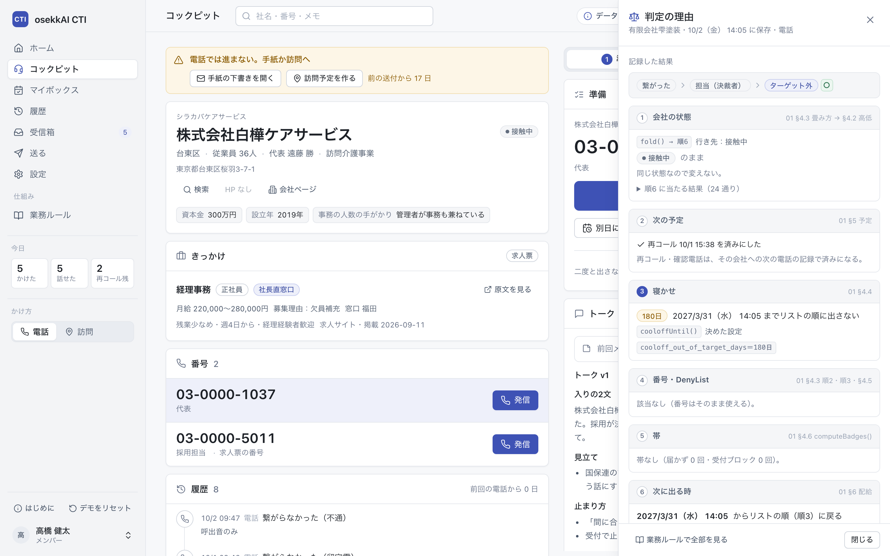
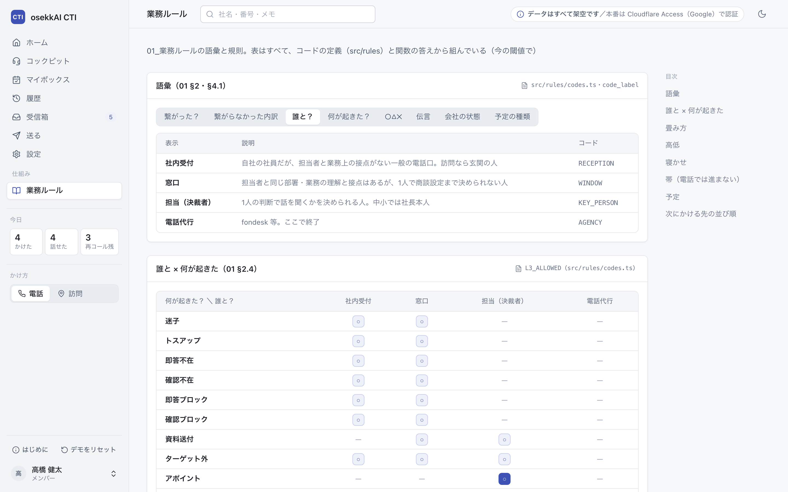
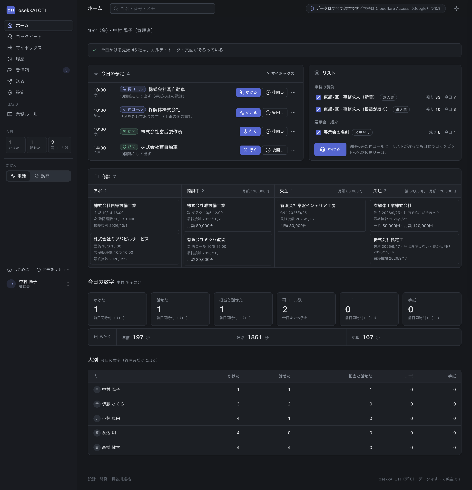

# osekkAI CTI デモ（架空データ・サーバーなし）

**デモ：https://pachikona.github.io/osekkai-cti-demo/**
（開くだけで動きます。ログインの登録は要りません。データはすべて架空です）

テレアポ・訪問・手紙の「接触」を1件ずつ記録し、業務ルールに沿って **会社の状態・次の予定・次にかける先** を自動で決める CTI（架電管理システム）です。
長谷川が自分の営業のために設計・開発し、実際に使っている物を、そのままブラウザ1ファイルで動くようにしました。

- サーバー・インストールは要りません。ブラウザの中だけで動き、外には何も送りません（`index.html` を保存して開いても動きます）
- データはすべて架空です（会社120社・人・番号 03-0000-xxxx・メール example.com）
- 画面・業務ルール・判定の処理は本番と同じコードです。違うのはサーバーと認証だけ（下の「本番との違い」）

## 3分で触る（採用担当の方へ）

1. デモを開き、**高橋 健太（メンバー）** を選ぶ → ホームの［かける］
2. コックピットで［発信］→［切った］→ 結果を押して［保存して次へ］（数字キーと Enter でも押せます）。右に出る **「判定の理由」** で、会社の状態・次の予定・寝かせがどのルールで決まったかが見えます
3. 左下の名前から **中村 陽子（管理者）** に切り替え、ホームの「人別」と、左の **「業務ルール」** を見る

左下の［デモをリセット］で、いつでも最初の状態に戻せます（［はじめに］で案内をもう一度出せます）。







## 何ができるか

| 画面 | 何をする所か |
|---|---|
| ホーム | 今日の予定・リストを選んでかける・商談（アポ／商談中／受注／失注）・今日の数字・人別（管理者） |
| コックピット | 1社ずつ 準備 → 通話 → 処理 → 次へ。期限の来た再コールが先頭に割り込む |
| マイボックス | 自分の予定（再コール・訪問・タスク）を 今日／明日以降／期限切れ で |
| 履歴 | 全社の接触を新しい順に。会社ページでは接触の修正・取り消し（修正すると状態を再計算） |
| 受信箱 | 手紙・メールへの返事や着信を「誰から・何が起きた・○△✕」で確定する |
| 送る | 手紙・メール・フォーム・SMS の文面を出して「送った」を記録する（**デモでは無効**） |
| 設定 | プロジェクトとリスト・型・フォーム・選択肢・閾値・ユーザー・DenyList・書き出し（CSV・連絡先） |
| 業務ルール | 語彙・「誰と × 何が起きた」の表・畳み方・高低・寝かせ・帯・予定・次にかける先の並び順（デモで追加） |

### ロジックの見える化（デモで追加した所）

- **判定の理由**：保存の直後に右から出ます。本番と同じルールの関数（`fold`・`nextState`・`cooloffUntil`・`computeBadges`）が返した値をそのまま表示します
- **業務ルール**：表はすべて、コードの定義と関数の答えから組んでいます（文章で書き直していません）。設定で閾値を変えると表も変わります。「次にかける先の並び順」は本物の配給の処理を試しに引いて並べています
- **状態の履歴**：会社ごとに、いつ・誰の記録で・どの状態に変わったか（自動なら「畳み方の何番」、人が変えたなら理由）

## 本番との違い

| | 本番 | このデモ |
|---|---|---|
| 業務ルール・判定の処理 | TypeScript（`src/rules`・API のルート） | **同じコードをそのまま**ブラウザの中で動かす |
| サーバー | Cloudflare Workers（Hono） | なし（同じ API をブラウザの中で動かす） |
| データベース | Cloudflare D1（SQLite） | ブラウザの中の SQLite（sql.js）。開いた日ごとに作り直し、同じ日は続きから |
| 認証 | Cloudflare Access（Google ログイン） | 起動時に使う人を選ぶ |
| データ | 実際の営業リスト | 架空の120社に、本物の処理で30営業日ぶんの架電を流して作った（アポ率 約3%） |
| 送る・回線とメールの受け口 | あり | デモでは無効 |

本番のテスト（ルール・配給・予定・保存・修正・状態の手動変更の 174 本）は、デモの中の SQLite の上でも全部通ります。

## 動作の確かめ

- Chromium（Chrome・Edge）と WebKit（Safari）で、10件続けて記録 → 毎回「判定の理由」 → ホームの実績と管理者の人別に反映、全画面の操作、リセットまで自動で確認（コンソールのエラー 0・外への通信 0）
- 画面の幅 375px〜1440px で横にはみ出さない。ライト／ダーク両方（右上で切り替え）

## ファイル

```
index.html      これだけで動く（約1.4MB。SQLite の本体を中に含む）
screenshots/    主な画面 40 枚（ライト・ダーク・スマホ幅）
```

ソース（本番のコードのコピーと、ブラウザで動かす層）は、このリポジトリには入れていません。

設計・仕様・検証・運用：長谷川雄祐／実装：仕様書をもとに Claude Code との対話で
